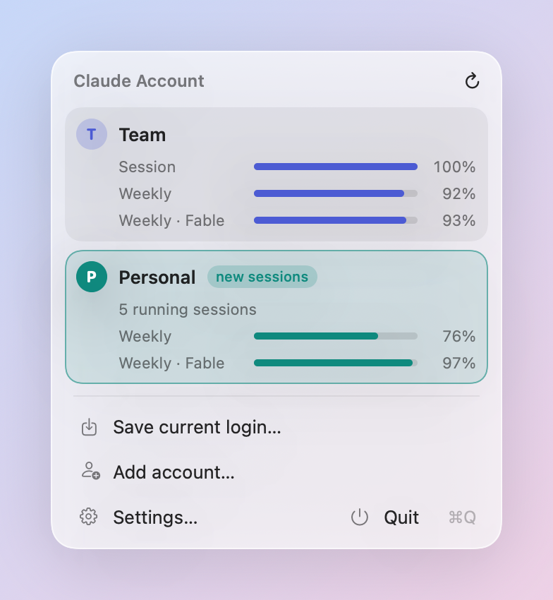
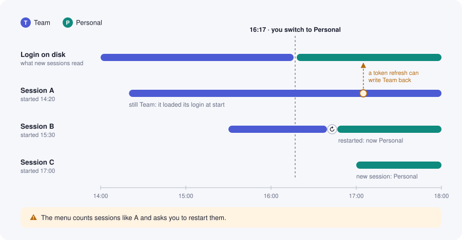
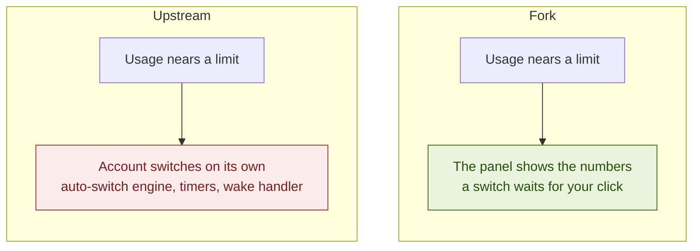
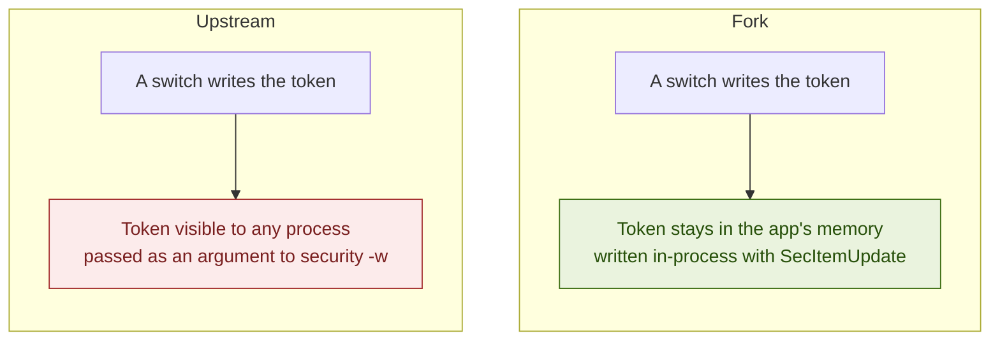
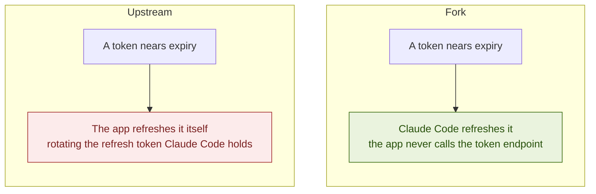
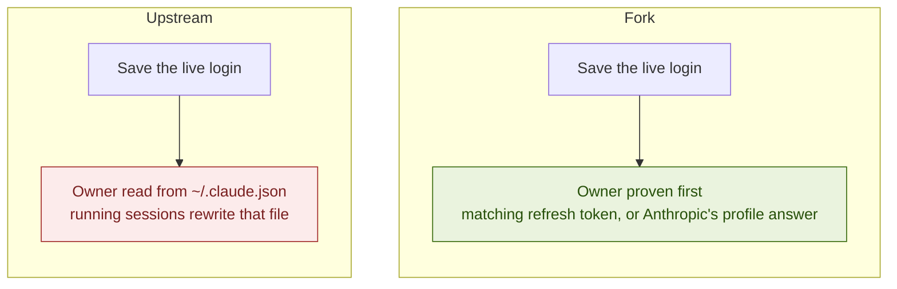
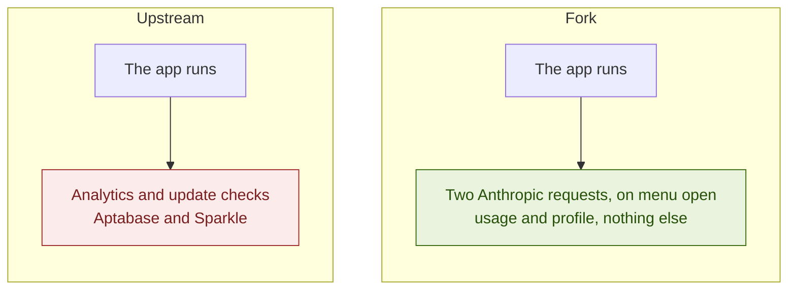

<p align="center">
  
</p>

<h1 align="center">CCSwitcher</h1>

<p align="center">
  Switch Claude Code between your Team and Personal logins from the menu bar.<br>
  Only when you click.
</p>

<p align="center">
  <picture>
    <source media="(prefers-color-scheme: dark)" srcset="docs/assets/ui-dark.png">
    
  </picture>
</p>

<p align="center">
  Each account keeps its own color. Bars show how much of each limit is left.<br>
  The tagged account is the one new Claude sessions will use.
</p>

## Install

Paste this into Claude Code or Codex on your Mac:

```text
Install CCSwitcher on this Mac by following https://raw.githubusercontent.com/adarshchbs/CCSwitcher/manual-switch-hardened/docs/INSTALL.md
```

The agent builds the app from source, runs the tests and tells you how to save your first two logins.

## What one click does

<picture>
  <source media="(prefers-color-scheme: dark)" srcset="docs/assets/switch-dark.svg">
  
</picture>

## After a switch

<picture>
  <source media="(prefers-color-scheme: dark)" srcset="docs/assets/sessions-dark.svg">
  
</picture>

Restart Claude Code (or T3 Code) after a switch, so every session picks up the new login.

## How this fork differs from upstream

This is a fork of [XueshiQiao/CCSwitcher](https://github.com/XueshiQiao/CCSwitcher), cut down after a security audit. Each diagram shows upstream's behavior on the left and this fork's on the right.

**1. Accounts change only when you click.**



**2. Tokens stay off the command line.**



**3. Only Claude Code refreshes its tokens.**



**4. A saved login is proven to belong to its organization.**



**5. Nothing phones home.**



[docs/FORK_SPEC.md](docs/FORK_SPEC.md) has the full rules and the audit's reasoning.

<details>
<summary><b>Known risks</b></summary>

Claude Code offers no lock or switching API, so these remain:

- **Token refresh race.** If Claude Code rotates its token in the milliseconds between the switch's read and write, the account you left needs `claude /login`.
- **`~/.claude.json` race.** A write Claude Code makes between the app's last check and its rename is lost.
- **Running sessions keep the old login** and can write it back when their token refreshes. The panel warns you; restart them.
- **The ownership check trusts Anthropic's profile endpoint** when the token matches no saved login. If it's unreachable, the app refuses to save or switch.

</details>

---

<sub>The original code is © 2026 XueshiQiao under the MIT License (see [LICENSE](LICENSE)). This fork keeps the same license.</sub>
