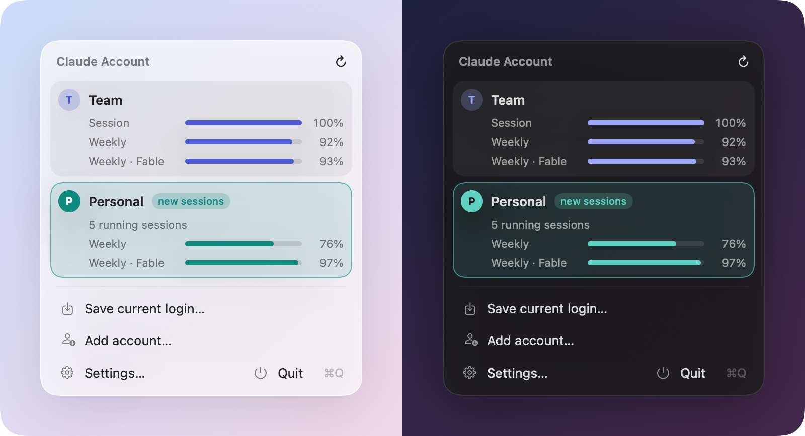
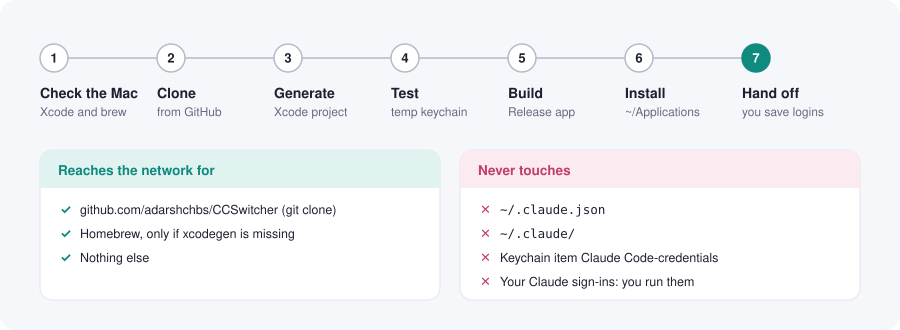
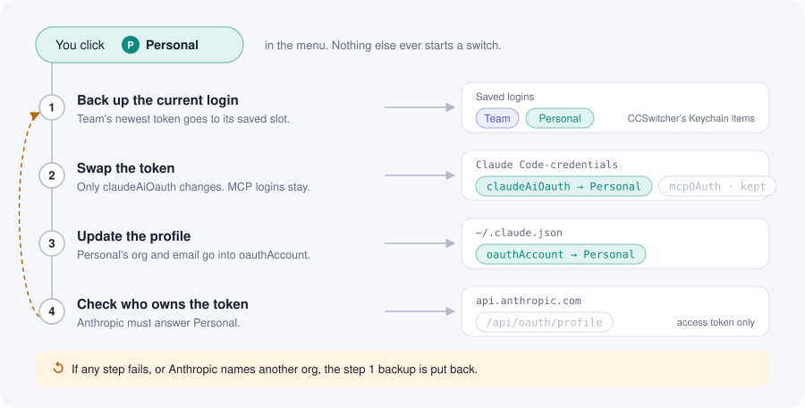
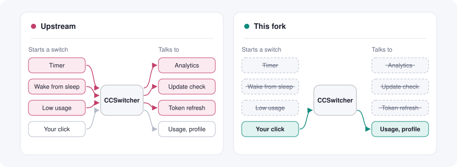
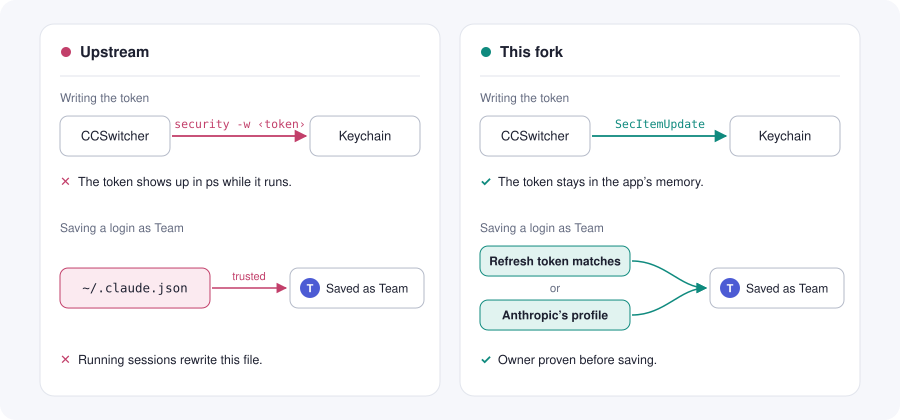

<p align="center">
  
</p>

<h1 align="center">CCSwitcher</h1>

<p align="center">
  Switch Claude Code between your Team and Personal logins from the menu bar.<br>
  Only when you click.
</p>

<p align="center">
  
</p>

<p align="center">
  Each account keeps its own color. Bars show how much of each limit is left.<br>
  The tagged account is the one new Claude sessions will use.
</p>

## Install

Copy the [install prompt](#install-prompt) at the bottom of this page and paste it into Claude Code or Codex. It's plain text with every command spelled out, so you can read exactly what the agent will run.

<picture>
  <source media="(prefers-color-scheme: dark)" srcset="docs/assets/install-dark.svg">
  
</picture>

## What one click does

<picture>
  <source media="(prefers-color-scheme: dark)" srcset="docs/assets/switch-dark.svg">
  
</picture>

## After a switch

<picture>
  <source media="(prefers-color-scheme: dark)" srcset="docs/assets/sessions-dark.svg">
  
</picture>

Restart Claude Code (or T3 Code) after a switch, so every session picks up the new login.

## How this fork differs from upstream

This is a fork of [XueshiQiao/CCSwitcher](https://github.com/XueshiQiao/CCSwitcher), cut down after a security audit. Dashed boxes are what the fork removed.

**What can make the app act**

<picture>
  <source media="(prefers-color-scheme: dark)" srcset="docs/assets/acts-dark.svg">
  
</picture>

**What happens to your token**

<picture>
  <source media="(prefers-color-scheme: dark)" srcset="docs/assets/token-dark.svg">
  
</picture>

[docs/FORK_SPEC.md](docs/FORK_SPEC.md) has the full rules and the audit's reasoning.

<details>
<summary><b>Known risks</b></summary>

Claude Code offers no lock or switching API, so these remain:

- **Token refresh race.** If Claude Code rotates its token in the milliseconds between the switch's read and write, the account you left needs `claude /login`.
- **`~/.claude.json` race.** A write Claude Code makes between the app's last check and its rename is lost.
- **Running sessions keep the old login** and can write it back when their token refreshes. The panel warns you; restart them.
- **The ownership check trusts Anthropic's profile endpoint** when the token matches no saved login. If it's unreachable, the app refuses to save or switch.

</details>

## Install prompt

<picture>
  <source media="(prefers-color-scheme: dark)" srcset="docs/assets/install-dark.svg">
  
</picture>

Paste all of this into Claude Code or Codex. Paste it again later to update; saved logins survive a reinstall.

```text
Install CCSwitcher, a macOS menu bar app that switches Claude Code between
saved logins. Build it from source, install it to ~/Applications, then hand
off to me.

Ground rules
- My Claude logins are mine. Leave ~/.claude.json, ~/.claude/ and the
  Keychain item "Claude Code-credentials" exactly as you found them. I run
  every Claude sign-in myself, from the app's menu.
- Network: git clone/fetch from github.com/adarshchbs/CCSwitcher, and
  brew install xcodegen if it is missing. Nothing else.
- Run the steps in order. Each ends on a check. If a check fails, stop and
  show me the command and the last 20 lines of its output.

1. Check the Mac. All four must pass:
   - sw_vers -productVersion: 14.0 or later.
   - xcodebuild -version: Xcode 26 or later (the glass panel needs the
     macOS 26 SDK). If it points at the Command Line Tools, ask me to
     install Xcode, open it once, then run:
       sudo xcode-select -s /Applications/Xcode.app
   - brew --version: prints a version.
   - At least one of these exists (Add account runs claude from them only):
       ~/.local/bin/claude  /opt/homebrew/bin/claude  /usr/local/bin/claude

2. Get the source. The fork is on branch manual-switch-hardened; main
   holds upstream's code. If ~/CCSwitcher is already a clone:
     git -C ~/CCSwitcher fetch origin
     git -C ~/CCSwitcher checkout manual-switch-hardened
     git -C ~/CCSwitcher pull --ff-only
   Otherwise:
     git clone --branch manual-switch-hardened \
       https://github.com/adarshchbs/CCSwitcher.git ~/CCSwitcher
   Check: the branch is manual-switch-hardened and git status is clean.

Run steps 3 to 6 from ~/CCSwitcher.

3. Generate the Xcode project:
     command -v xcodegen || brew install xcodegen
     xcodegen generate
   Check: CCSwitcher.xcodeproj exists.

4. Run the tests:
     xcodebuild -project CCSwitcher.xcodeproj -scheme CCSwitcher \
       -derivedDataPath build test
   They use a throwaway keychain in a temp directory and never open a
   dialog. If a Keychain password dialog appears, tell me to click Deny,
   then stop.
   Check: the output ends with ** TEST SUCCEEDED **.

5. Build the app:
     xcodebuild -project CCSwitcher.xcodeproj -scheme CCSwitcher \
       -configuration Release -derivedDataPath build build
   Check: the output ends with ** BUILD SUCCEEDED **.

6. Install and launch. Quit a running copy with pkill; osascript's quit
   fails with error -128 for this menu bar app.
     pkill -x CCSwitcher || true
     ditto build/Build/Products/Release/CCSwitcher.app \
       ~/Applications/CCSwitcher.app
     open ~/Applications/CCSwitcher.app
   Check: pgrep -x CCSwitcher prints a PID, and shasum prints the same
   hash for Contents/MacOS/CCSwitcher in both copies of the app.

7. Hand off. Tell me the commit (git rev-parse --short HEAD), then:
   a. Click the person icon in the menu bar to open CCSwitcher.
   b. With claude signed in to my first organization, choose
      Save current login... and name it, for example Team.
   c. Choose Add account..., pick the other organization in the browser,
      and name it, for example Personal.
   d. Click an account to switch. When macOS asks about
      "Claude Code-credentials" or "CCSwitcher saved login", choose
      Always Allow. The app is signed ad hoc, so it asks again after each
      rebuild.
   e. After a switch, restart Claude Code, or quit and reopen T3 Code.
      Running sessions keep the old login until they restart.
```

<details>
<summary><b>Uninstall</b></summary>

Remove each account in **Settings…** first, which deletes its saved login. Then quit CCSwitcher and move `~/Applications/CCSwitcher.app` to the Trash. Logins left behind stay in the login keychain under the service `com.adarshchbs.ccswitcher.account`, where Keychain Access can delete them.

</details>

---

<sub>The original code is © 2026 XueshiQiao under the MIT License (see [LICENSE](LICENSE)). This fork keeps the same license.</sub>
